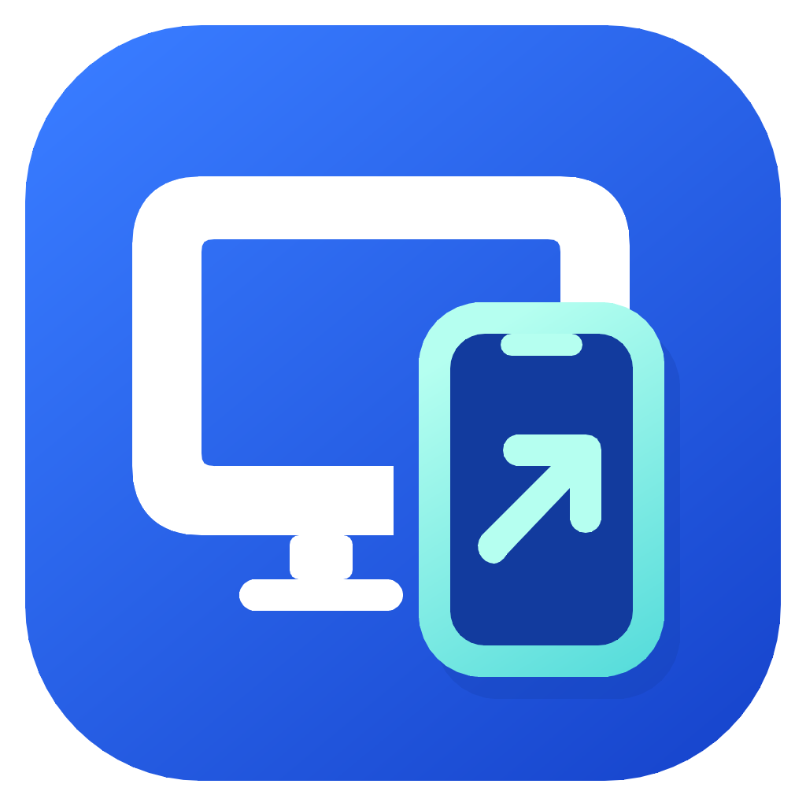
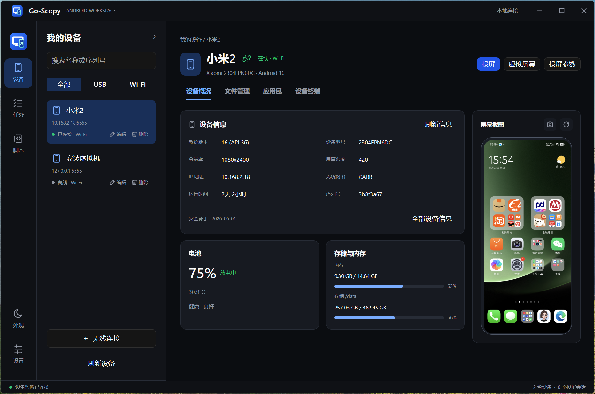
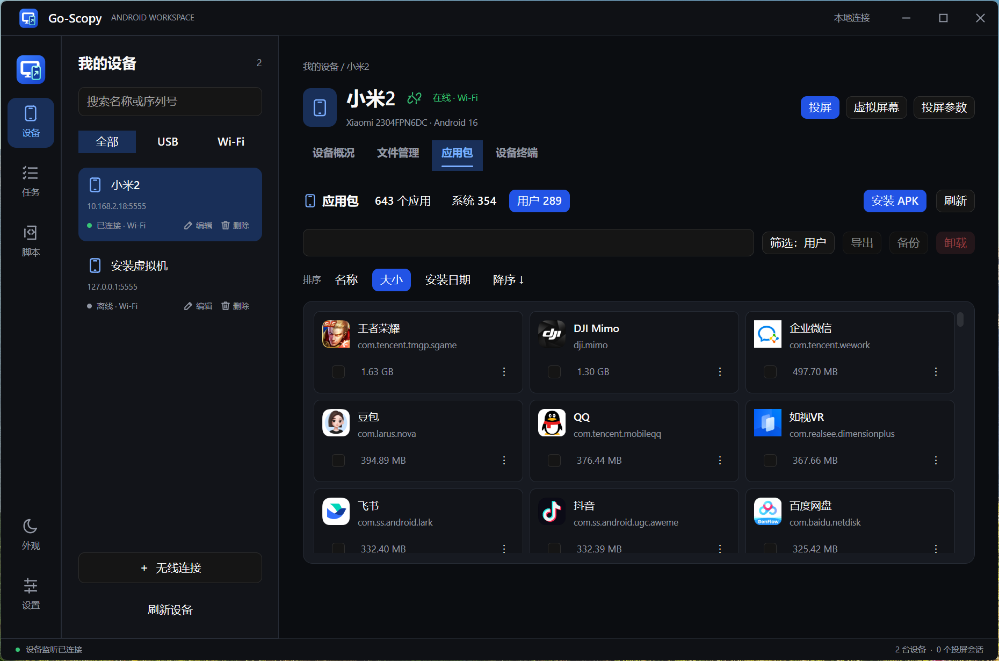
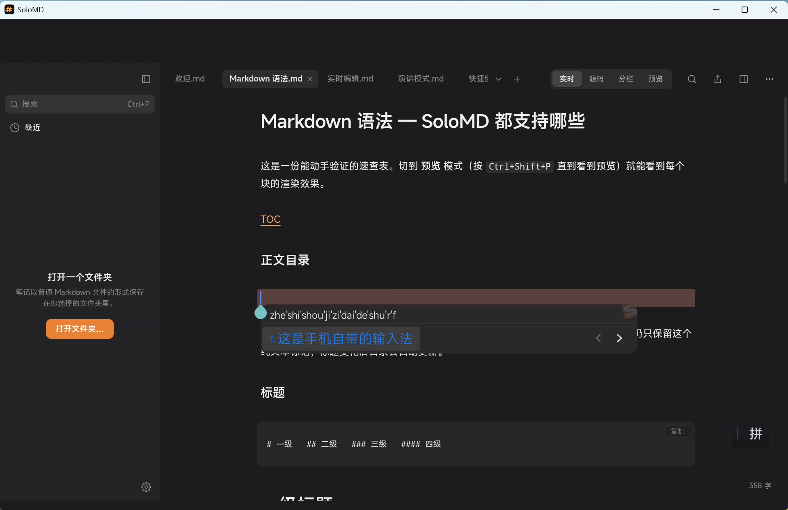

# Go-Scopy

**Your Android, on your desktop.**

A simple Android screen mirroring and control app for Windows, macOS, and Linux.

**English** · [简体中文](README.zh-CN.md)

[Download](https://github.com/sweetwisdom/go-scopy/releases/latest) · [Report an issue](https://github.com/sweetwisdom/go-scopy/issues)

  

<table>
  <tr>
    <td width="50%"></td>
    <td width="50%"></td>
  </tr>
</table>

## Highlights

- **Mirror and control** — Bring your phone to your desktop and interact with it using your mouse and keyboard. Open separate mirroring sessions for multiple devices.
- **USB or Wi-Fi** — Connect over USB, pair wirelessly, or switch from USB to Wi-Fi. Save wireless devices for easy connection and disconnection.
- **Make devices your own** — Rename devices and add, edit, or remove saved wireless addresses. Keep saved devices in your list even when they are offline.
- **Record and capture** — Record your screen, save screenshots, enable audio forwarding when needed, and choose where your captures are stored.
- **An island for your controls** — On Windows, a compact floating capsule expands into phone controls. Drag it freely and snap it to a screen edge, while your scrcpy window stays independent. Open the main screen's foreground app in its own virtual-display window, then return the original mirror to the launcher. Start or stop recording from the island (switching restarts the session).
- **Preferences for each device** — Tune resolution limits, frame rate, bitrate, audio, and always-on-top behavior. Virtual displays also remember their settings and last app per device, with defaults and saved profiles editable in Settings.
- **Web file workspace** — Browse in list or grid view, use right-click actions, upload multiple files or whole folders with their structure preserved, and track file operations. Preview images, UTF-8 text/code, and supported media; the native file page remains a fallback.
- **App management** — Browse compact cards that fit more columns on wider windows and keep long names readable. Show user apps by default, sort by name, size, or installation date, and drag the scrollbar to browse. Open the three-dot button for app details, export, backup, or uninstall; system app icons load on request.
- **Multiple virtual app windows** — Launch separate virtual displays alongside ordinary mirroring, with portrait, phone landscape, and tablet landscape presets. Closing a virtual display ends its app tasks by default, keeping them from jumping to the phone screen. Repeated launches of the same app remain subject to Android task and multi-display support.
- **Keyboard options** — Tablet mode uses an external keyboard mode for input through the phone's input method. For Chinese, type pinyin with the computer keyboard set to English and select candidates on Android, or paste text with Ctrl+V. Compatibility depends on the phone and its input method.
- **Device tools** — View battery, memory, and storage, or open an interactive shell and live Logcat.
- **Everyday tools, together** — Install APKs, review operation results in the task center, and switch between light and dark themes.

## On your desktop

| Platform | Architecture | Mirroring experience |
| --- | --- | --- |
| Windows | x64 | Native scrcpy window with an independent, edge-snapping control island |
| macOS | Intel / Apple Silicon | Standalone scrcpy window |
| Linux | x64 / ARM64 | Standalone scrcpy window |

Release packages include adb and scrcpy for your platform.

---

Built with [Viva](https://github.com/vivaui/viva) and [scrcpy](https://github.com/Genymobile/scrcpy). Inspired by [GoIM](https://github.com/Ezreal-byte/GoIM) and [escrcpy](https://github.com/viarotel-org/escrcpy).

[MIT License](LICENSE) · [Third-party notices](THIRD_PARTY_NOTICES.md)

## Python automation

Run trusted local Python scripts for a selected device, with live logs, timeouts and cancellation. UI automation uses uiautomator2 in a separate Python process. The default interpreter comes from PATH; a custom interpreter can be selected. Packages do not include Python or its third-party dependencies. See the [scripting guide](docs/python-script-development.md) for setup and usage.

## Installation and screen previews (v0.1.13)

- **Windows x64**: run the `-setup.exe` installer, or extract the portable ZIP and run `Go-Scopy.exe`.
- **macOS 13.0+**: choose the Intel or Apple Silicon DMG and drag `Go-Scopy.app` into Applications. Ad-hoc signed, not Apple-notarized. ZIP packages remain available.
- **Linux x64 / ARM64**: on Ubuntu 24.04 or a compatible Debian environment, run `sudo apt install ./Go-Scopy-0.1.13-linux-amd64.deb` (use `arm64` on ARM64). Launch from the application menu or `go-scopy`. Removing the package leaves personal settings intact. Other distributions can use tar.gz with desktop/X11/XCB, xkbcommon, Vulkan, and libudev dependencies installed separately.
- Device connection, reconnection, and entering the overview trigger a screenshot. Settings → General controls the interval: 5 seconds by default, 1–300 seconds, or 0 to disable periodic refresh. Refresh pauses outside the overview and while minimized. Previews stay in memory unless explicitly saved.
- App labels and icons are cached globally by package name, with an explicit clearing option. Runtime diagnostics are written to `startup.log` and `crash.log` in the configuration directory.
