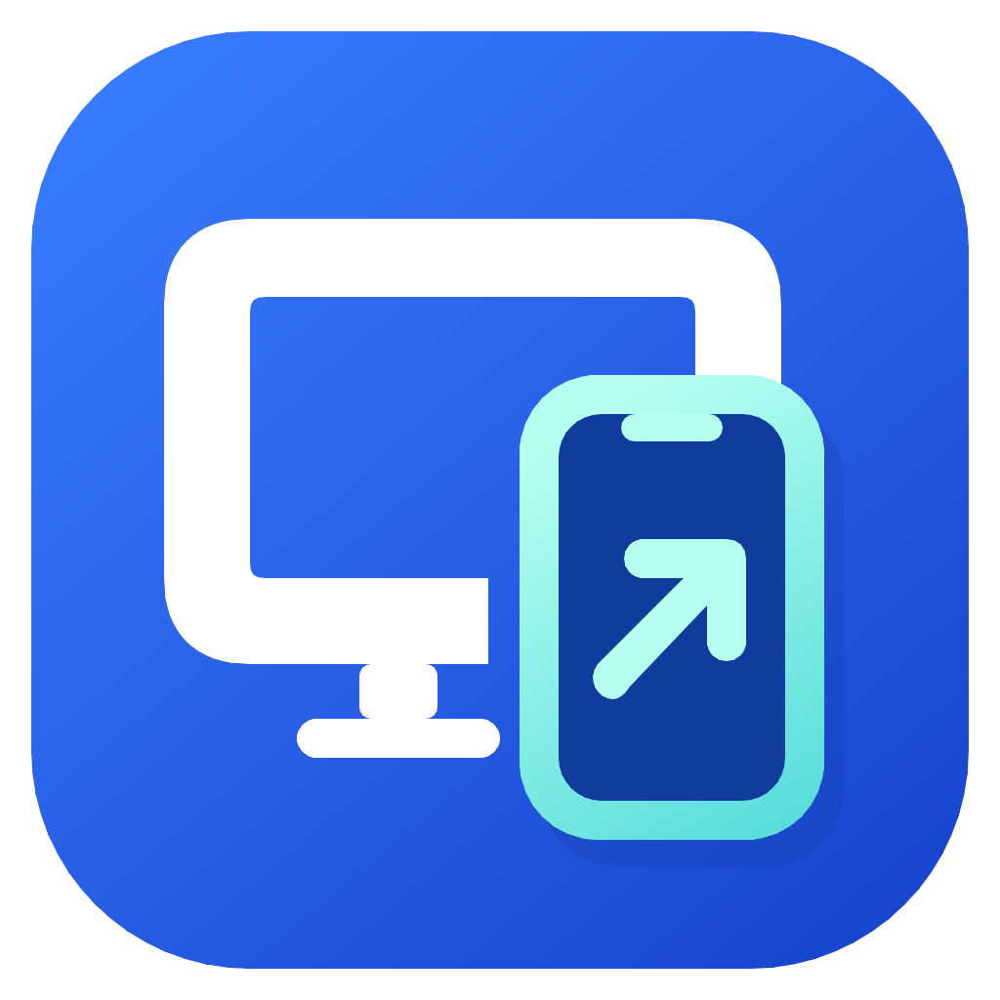
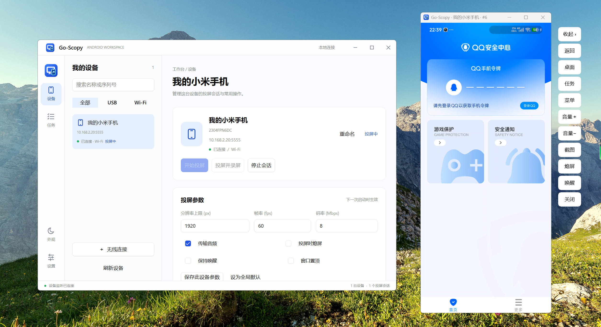

# Go-Scopy

**Your Android, on your desktop.**

A simple Android screen mirroring and control app for Windows, macOS, and Linux.

**English** · [简体中文](README.zh-CN.md)

[Download](https://github.com/sweetwisdom/go-scopy/releases/latest) · [Report an issue](https://github.com/sweetwisdom/go-scopy/issues)

## Highlights

- **Mirror and control** — Bring your phone to your desktop and interact with it using your mouse and keyboard. Open separate mirroring sessions for multiple devices.
- **USB or Wi-Fi** — Connect over USB, pair wirelessly, or switch from USB to Wi-Fi. Save wireless devices for easy connection and disconnection.
- **Make devices your own** — Rename devices and add, edit, or remove saved wireless addresses. Keep saved devices in your list even when they are offline.
- **Record and capture** — Record your screen, save screenshots, enable audio forwarding when needed, and choose where your captures are stored.
- **Floating controls on Windows** — A phone-shaped mirroring window with a transparent, collapsible toolbar. Access Back, Home, Recent Apps, Menu, volume, and screen controls in one place.
- **Preferences for each device** — Tune resolution limits, frame rate, bitrate, audio, and always-on-top behavior. Save settings per device or as your defaults.
- **Everyday tools, together** — Install APKs, review operation results in the task center, and switch between light and dark themes.

## On your desktop

| Platform | Architecture | Mirroring experience |
| --- | --- | --- |
| Windows | x64 | Embedded window with collapsible floating controls |
| macOS | Intel / Apple Silicon | Standalone scrcpy window |
| Linux | x64 / ARM64 | Standalone scrcpy window |

Release packages include adb and scrcpy for your platform.

---

Built with [Viva](https://github.com/vivaui/viva) and [scrcpy](https://github.com/Genymobile/scrcpy). Inspired by [GoIM](https://github.com/Ezreal-byte/GoIM) and [escrcpy](https://github.com/viarotel-org/escrcpy).

[MIT License](LICENSE) · [Third-party notices](THIRD_PARTY_NOTICES.md)
