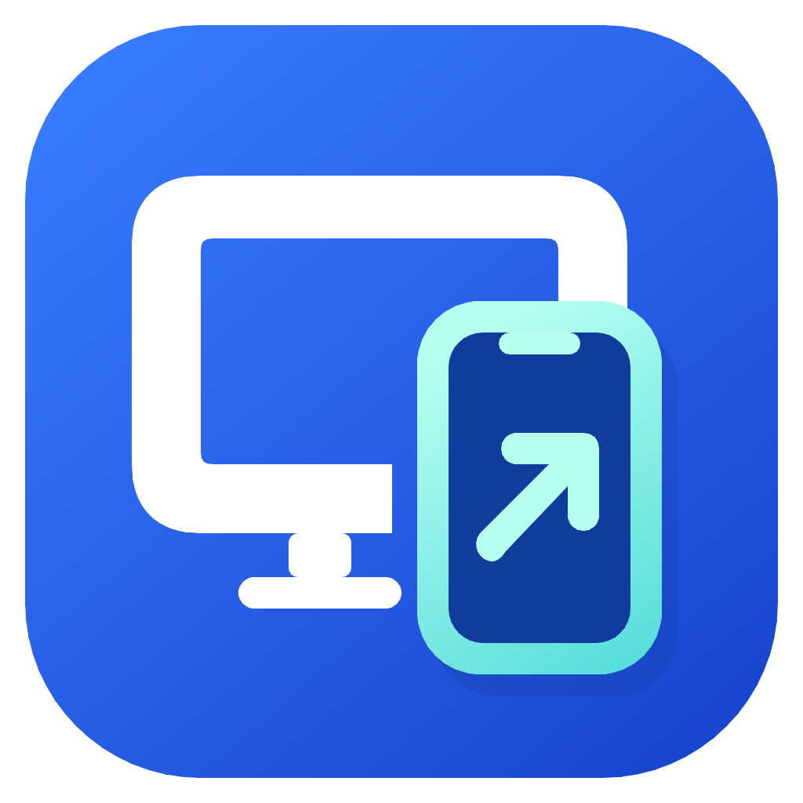
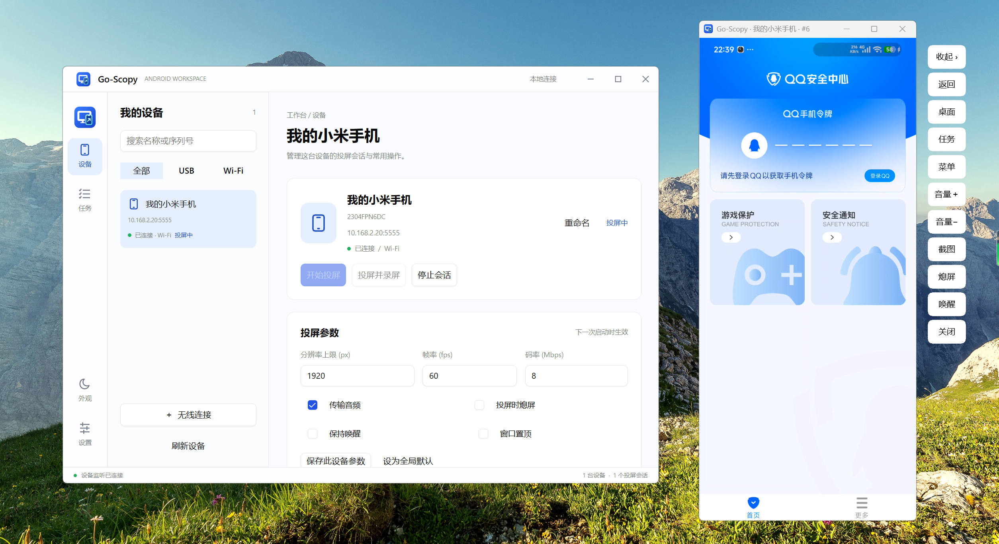

# Go-Scopy

**在电脑上，看见并掌控你的 Android。**

一款简洁的 Android 投屏与控制工具，支持 Windows、macOS 和 Linux。

[English](README.md) · **简体中文**

[下载最新版](https://github.com/sweetwisdom/go-scopy/releases/latest) · [反馈问题](https://github.com/sweetwisdom/go-scopy/issues)

## 功能亮点

- **投屏与控制** — 将手机画面显示在电脑上，直接使用鼠标和键盘操作。支持同时为多台设备开启独立投屏窗口。
- **USB 与无线连接** — 支持 USB 调试、无线配对与 USB 转 Wi-Fi，保存常用无线设备，随时连接或断开。
- **设备管理** — 为设备重命名，新增、编辑和删除已保存的无线地址，离线设备也能保留在列表中。
- **录屏与截图** — 录制投屏画面、保存手机截图，按需开启音频转发，并自定义保存位置。
- **Windows 悬浮工具栏** — 内嵌投屏窗口贴合手机比例，透明工具栏可收起；返回、桌面、最近任务、菜单、音量与屏幕控制触手可及。
- **按设备保存偏好** — 调整分辨率上限、帧率、码率、音频和置顶选项，为单台设备保存配置，或设为全局默认。
- **日常操作更集中** — 安装 APK，在任务中心查看操作结果，自由切换浅色与深色主题。

## 桌面平台

| 平台 | 架构 | 投屏体验 |
| --- | --- | --- |
| Windows | x64 | 内嵌投屏与可收起的悬浮工具栏 |
| macOS | Intel / Apple Silicon | scrcpy 独立窗口 |
| Linux | x64 / ARM64 | scrcpy 独立窗口 |

发布包已附带对应平台的 adb 与 scrcpy。

---

基于 [Viva](https://github.com/vivaui/viva) 与 [scrcpy](https://github.com/Genymobile/scrcpy) 构建，参考 [GoIM](https://github.com/Ezreal-byte/GoIM) 与 [escrcpy](https://github.com/viarotel-org/escrcpy)。

[MIT 许可证](LICENSE) · [第三方声明](THIRD_PARTY_NOTICES.md)
