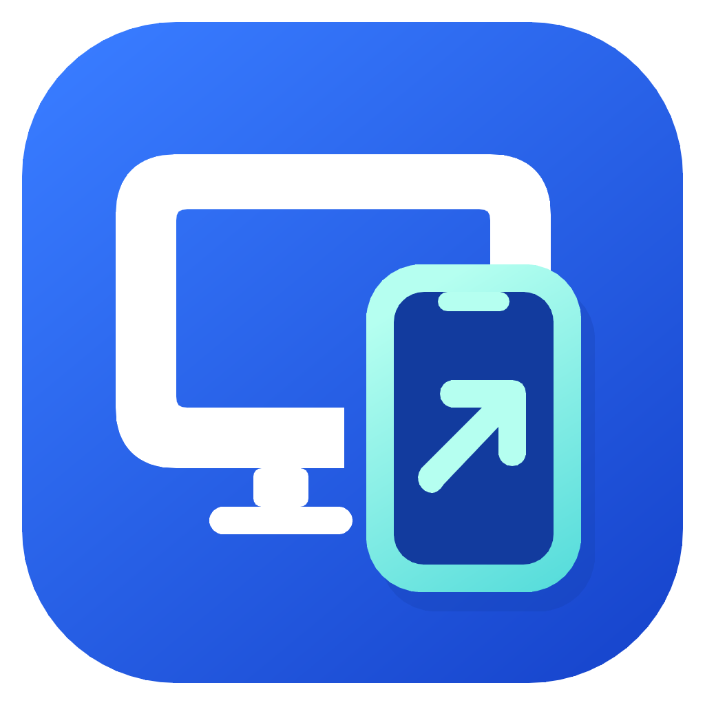

# Go-Scopy

**在电脑上，看见并掌控你的 Android。**

一款简洁的 Android 投屏与控制工具，支持 Windows、macOS 和 Linux。

[English](README.md) · **简体中文**

[下载最新版](https://github.com/sweetwisdom/go-scopy/releases/latest) · [反馈问题](https://github.com/sweetwisdom/go-scopy/issues)

## 功能亮点

- **投屏与控制** — 将手机画面显示在电脑上，直接使用鼠标和键盘操作。支持同时为多台设备开启独立投屏窗口。
- **USB 与无线连接** — 支持 USB 调试、无线配对与 USB 转 Wi-Fi，保存常用无线设备，随时连接或断开。
- **设备管理** — 为设备重命名，新增、编辑和删除已保存的无线地址，离线设备也能保留在列表中。
- **录屏与截图** — 录制投屏画面、保存手机截图，按需开启音频转发，并自定义保存位置。
- **Windows 灵动岛控制窗** — 小巧的悬浮胶囊，点击展开手机操作，自由拖动并吸附屏幕边缘。投屏保留 scrcpy 原生窗口，控制窗独立摆放。 支持将主屏当前应用一键打开为独立虚拟屏窗口，成功后原投屏返回桌面；可开始／停止录屏（切换会重启投屏）。
- **按设备保存偏好** — 调整分辨率上限、帧率、码率、音频和置顶选项，为单台设备保存配置，或设为全局默认。
- **Web 文件工作台** — 内嵌列表／网格、多选、路径导航和文件操作状态；可只读预览图片、UTF-8 文本／代码，以及系统 WebView 支持的音视频。缺少 WebView 时回退原生文件页。
- **设备工作台** — 查看设备、电池、内存与存储概况，管理设备文件和已安装应用（导出／备份／卸载）。
- **设备终端与虚拟屏幕** — 提供交互式 Shell、实时 Logcat；同设备可同时启动多个独立虚拟 App 窗口，与普通投屏并行，分别显示/停止会话。同一 App 重复启动仍受 Android 任务与多显示器支持限制；可按需选择 SDK／UHID 键盘模式。
- **日常操作更集中** — 安装 APK，在任务中心查看操作结果，自由切换浅色与深色主题。

## 桌面平台

| 平台 | 架构 | 投屏体验 |
| --- | --- | --- |
| Windows | x64 | scrcpy 原生窗口与独立、可吸附屏幕边缘的灵动岛控制窗 |
| macOS | Intel / Apple Silicon | scrcpy 独立窗口 |
| Linux | x64 / ARM64 | scrcpy 独立窗口 |

发布包已附带对应平台的 adb 与 scrcpy。

---

基于 [Viva](https://github.com/vivaui/viva) 与 [scrcpy](https://github.com/Genymobile/scrcpy) 构建，参考 [GoIM](https://github.com/Ezreal-byte/GoIM) 与 [escrcpy](https://github.com/viarotel-org/escrcpy)。

[MIT 许可证](LICENSE) · [第三方声明](THIRD_PARTY_NOTICES.md)

## Python automation / Python 脚本

支持按设备运行本地 Python 脚本、实时日志、超时和停止。UI 自动化使用 uiautomator2，独立运行于 PATH 默认的 Python 环境，也可手动指定解释器。发行包不携带 Python 解释器或第三方依赖。准备与使用见 [Python 脚本文档](docs/python-script-development.md)。

## 安装与屏幕预览（v0.1.12）

- **Windows x64**：下载 ZIP，解压运行 `Go-Scopy.exe`。
- **macOS 13.0+**：选择 Intel / Apple Silicon 对应的 DMG，将 `Go-Scopy.app` 拖到 Applications。仅提供 ad-hoc 签名，未经 Apple 公证；也保留 ZIP。
- **Linux x64 / ARM64**：在 Ubuntu 24.04 或兼容 Debian 环境使用 `sudo apt install ./Go-Scopy-0.1.12-linux-amd64.deb`（ARM64 改为 `arm64`），从应用菜单或 `go-scopy` 启动。卸载 `sudo apt remove go-scopy` 不删除个人配置。其他发行版可使用 tar.gz 并自行安装图形桌面、X11/XCB、xkbcommon、Vulkan、libudev 等依赖。
- 设备连接、重连和进入设备概况时立即刷新屏幕；设置 → 常规 → 设备屏幕预览可设置刷新间隔，默认 5 秒，1–300 秒可调，0 关闭定时刷新。离开概况页、最小化时暂停；截图仅保存在内存中，手动保存才生成文件。
- 应用名称和图标按包名全局复用，设置中可清理；Windows 默认缓存位于 `%APPDATA%\Go-Scopy\cache\apps-v2`，运行时异常记录在同一配置根目录的 `startup.log` 和 `crash.log`。
